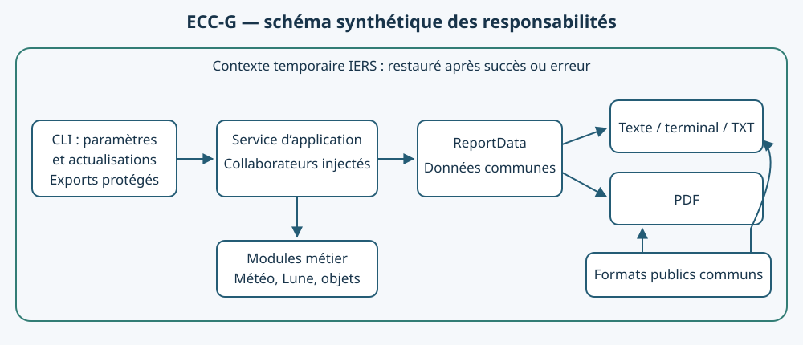

# Service d’application et rapport partagé — ECC-G

Ce guide décrit une séparation interne. Les commandes et options restent les
mêmes. Aucun service supplémentaire n’est nécessaire.

## Parcours simple

1. La commande vérifie les nombres et les destinations. Elle conserve les
   protections ECC-A et ECC-C avant les actualisations.
2. Le service d’application prépare les données. Un service d’application est
   le chef d’orchestre : il appelle les modules qui savent calculer.
3. `ReportData` rassemble les résultats, la météo, la Lune et les notes.
4. Le rendu texte et le rendu PDF reçoivent les mêmes données.
5. En quittant la commande, les réglages IERS et les ressources de catalogues
   retrouvent leur état précédent, même après une erreur.

Le dessin est un schéma synthétique, pas une capture d’écran ni un résultat
astronomique. Les exemples des tests sont également synthétiques.

## Contrats Python

`application.ObservationRequest` décrit les paramètres du calcul sans dépendre
d’un parseur ou d’un chemin d’export. `validate()` contrôle les nombres, le champ,
les options de catalogues et les budgets avant tout collaborateur. La CLI garde
son précontrôle complet avant les actualisations et les exports.

`ObservationApplication.prepare_report(request, source_notes=(),
seestar_root=None)` renvoie un `ReportData`. Cette méthode ne produit ni sortie
terminale ni fichier de rapport. Elle peut lire les catalogues et appeler les
collaborateurs météo selon `offline`; les dépendances injectées permettent des
tests sans calcul réel ni réseau. Le scanner Seestar conserve son contrat de
lecture seule. Les actualisations, leur cache et les protections de destinations
restent gérés par l’adaptateur CLI et leurs modules existants.

`ApplicationDependencies` déclare explicitement les fonctions de chargement,
calcul et annotation. Un test peut remplacer une fonction avec
`dataclasses.replace(dependencies, compute_weather_summary=fake_weather)` et
construire `ObservationApplication(dependencies)`. Il n’est pas nécessaire de
modifier les modules astronomiques. La CLI construit ces dépendances à chaque
appel depuis ses symboles publics : un monkeypatch de
`cli.compute_weather_summary`, notamment, reste effectif.

`ReportData.to_kwargs()` crée un nouveau dictionnaire compatible avec
`render_report(**data.to_kwargs())` et
`export_pdf_report(path, **data.to_kwargs())`. Il ne fait pas de copie profonde
des objets métier. Le service fige la séquence de résultats dans un tuple,
et conserve l’effectif avant `limit`. Le DTO est une enveloppe gelée, pas une
promesse d’immuabilité profonde pour tout objet fourni par un appelant direct.
Les signatures historiques des deux rendus restent disponibles.

`report_formatting` expose `object_name`, `magnitude_label`, `number`,
`apparent_size_label`, `reference_label`, `crossing_time_label` et
`moon_event_label`. Les deux rendus les utilisent. Les anciens noms privés du
rendu texte restent des alias de compatibilité; le PDF n’importe plus ce module.
Aucune donnée ou règle photométrique n’est ajoutée ou modifiée.

## Isolation et limites

`astronomical_context(offline)` utilise les contextes temporaires Astropy pour
`auto_download`, `auto_max_age` et `iers_degraded_accuracy`. Un verrou réentrant
sérialise les utilisateurs de ce contexte dans le processus. Le service protège
ses appels directs; la CLI englobe aussi l’actualisation, les ressources, les
rendus et les exports. Les contextes imbriqués restaurent l’état de leur parent.

Ce verrou ne protège pas un code externe qui modifie directement les réglages
Astropy. Il ne réinitialise pas les caches internes de tables Astropy et ne
promet pas une isolation entre processus. `use_catalog_resources` continue à
restaurer les ressources et vider ses caches suivant son contrat existant.

## Vérifications

Les tests de `tests/test_application.py` couvrent l’injection sans CLI, les
contrôles avant collaborateurs, le rapport partagé, les API TXT/PDF, les
contextes imbriqués, les erreurs de chargement, météo, Lune, visibilité et
inventaire, puis les erreurs d’actualisation, rendu et export de la CLI.
Une deuxième commande simule le mode en ligne sans aucune connexion réelle et
vérifie que ni les ressources ni les réglages hors ligne ne fuient.

La décision et ses compromis sont dans
[l’ADR 0007](architecture/decisions/0007-service-application-rapport.md).
Les commandes de contrôle utilisent le Python déjà installé, `PYTHONPATH=src`
et un `--basetemp` dans `.pytest_cache` du worktree. Aucun disque Seestar réel
ni réseau n’est utilisé. Les résultats des contrôles locaux ne constituent pas
une validation scientifique externe.

### Résultats de la vérification locale

Dans le worktree `local/ecc-g-work`, avec le Python du `.venv` parent et
`PYTHONPATH` pointant explicitement vers le `src` de ce worktree :

- Suite complète : **597 réussis, 3 ignorés**, 27 avertissements IERS/ERFA.
- Ruff : réussi sur le dépôt.
- Contrôle des documents, liens locaux et versions : réussi.
- `git diff --check` et analyse XML du SVG : réussis.

Le fichier dédié ECC-G ajoute 33 cas déterministes (paramétrages compris).
L’ancien test CLI qui attendait une fuite de configuration IERS vérifie
maintenant la restauration de l’état reçu. Les autres tests restent inchangés.
Sous Windows, l’exécution restreinte a refusé les dossiers temporaires pytest;
les contrôles réussis ont utilisé l’autorisation d’exécution locale, toujours
avec `--basetemp` sous `.pytest_cache` du worktree et le blocage réseau des tests.
Aucun contrôle distant ni validation scientifique externe n’est revendiqué.
