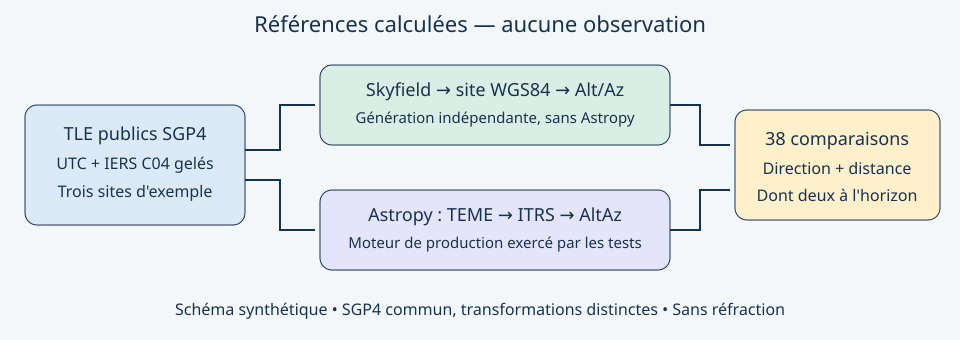

# ECC-H — Références satellitaires calculées

Ces références sont des **calculs**, pas des observations. Elles comparent les
transformations topocentriques complètes. Elles ne mesurent pas l'erreur réelle
d'une orbite TLE, ni la précision d'un télescope.



## Sources, licences et acquisition

Extraction locale et vérification des pages officielles : **17 novembre 2026**.
Cette date désigne notre extraction, pas la première publication des données.

| Entrée | Provenance épinglée | Conditions et attribution |
| --- | --- | --- |
| Quatre TLE de vérification | `sgp4 2.25`, fichier `sgp4/SGP4-VER.TLE` | MIT, © 2012–2016 Brandon Rhodes; texte intégral [conservé](../tests/data/satellite_reference_sgp4_LICENSE.txt) |
| Rotation terrestre C04 | `astropy-iers-data 0.2025.12.22.0.40.30`, `data/eopc04.1962-now` | Distribution BSD-3-Clause, © 2023 Astropy Developers; [notice intégrale](../tests/data/satellite_reference_iers_LICENSE.txt). Données produites par IERS/EOP Product Centre, Observatoire de Paris; leur attribution est conservée. Aucune nouvelle licence GPL attribuée aux données sources. |
| Sites | Greenwich 51,4779°/0°/46 m; grille équatoriale 0°/0°/0 m; exemple urbain Sydney −33,8688°/151,2093°/0 m | Paramètres publics d'exemple, sans domicile ni mesure géodésique revendiquée. Les hauteurs choisies définissent le calcul. |

Les TLE sélectionnés sont NORAD **5, 6251, 8195, 14128**, couvrant orbites
proche, excentrique, résonante et presque géosynchrone. Les noms, heures et
chiffres des TLE sont ceux du paquet; seules les 69 colonnes TLE sont conservées,
sans les plages de vérification ajoutées par Vallado après la ligne 2.

Sources primaires consultées : [SGP4 2.25 et origine Vallado](https://pypi.org/project/sgp4/2.25/),
[guide satellites Skyfield](https://rhodesmill.org/skyfield/earth-satellites.html),
[temps Skyfield](https://rhodesmill.org/skyfield/time.html),
[mouvement du pôle Skyfield](https://rhodesmill.org/skyfield/accuracy-efficiency.html),
[format C04 officiel](https://hpiers.obspm.fr/eoppc/eop/eopc04/readme),
[licence du paquet IERS](https://github.com/astropy/astropy-iers-data/blob/main/LICENSE.rst),
[transformation satellitaire Astropy](https://docs.astropy.org/en/stable/coordinates/satellites.html).
La page C04 actuelle peut décrire une révision ultérieure : la reconstruction
emploie exclusivement la version du paquet et les empreintes ci-dessous.

SHA-256 des sources **octet pour octet**, vérifiés par le générateur :

```text
SGP4-VER.TLE
d246d1d9d768ace445a38a965713fa9ba52d80fd8a41a0502ff83d7acffe2881
eopc04.1962-now
d7c84f0357d6b60f99884ccb8bb6efd8ca1c6415d684383bf2dc58951dee14c0
satellite_reference.json (sortie LF UTF-8)
68c9739fc51dd19e3a880cc1646dcf8f99f770bb320d99405557870ede00046a
```

## Indépendance et conventions

Le générateur n'importe ni Astropy ni GNU Astrolist. Skyfield 1.54 effectue
SGP4 → repère céleste → soustraction du site WGS84 → Alt/Az. Le moteur testé
effectue SGP4 → TEME → ITRS Astropy → soustraction du site → AltAz Astropy.
SGP4 2.25 reste commun; ses vecteurs sont déjà comparés à `tcppver.out` dans
`tests/test_satellites.py`. Cette nouvelle comparaison ne constitue donc pas
un second propagateur SGP4 indépendant.

Les entrées de rotation terrestre sont communes, leurs transformations ne le
sont pas. Le générateur lit directement quatre colonnes C04 : MJD UTC, xp et yp
en secondes d'arc, UT1−UTC en secondes. Il conserve les lignes autour des époques
dans la fixture. Skyfield interpole linéairement ces valeurs et reçoit
ΔT = TT−UTC−(UT1−UTC). Le test construit temporairement une table IERS depuis
ces mêmes nombres, puis restaure le contexte en sortie. On évite ainsi de
confondre une différence de table embarquée avec une erreur de transformation.
Les intervalles disjoints entre années ne sont jamais interrogés.

UTC définit les instants; les secondes intercalaires de Skyfield sont embarquées.
SGP4 utilise ses constantes WGS72 par défaut, le site son ellipsoïde WGS84.
Longitude positive vers l'est; latitude géodésique; hauteur ellipsoïdale en mètres.
Azimut depuis le nord vers l'est, modulo 360°; altitude géométrique; distance
topocentrique en kilomètres. Aucune réfraction, aucun temps de trajet lumineux,
aucun relief et aucune correction météorologique. Les décalages célestes dX/dY
ne sont pas utilisés par ces transformations TEME. La magnitude reste inconnue.

La fixture contient 36 positions : quatre TLE × trois sites × trois instants
(époque Skyfield convertie en datetime UTC à la microseconde, +30 min, +90 min).
Deux positions supplémentaires encadrent un lever géométrique de NORAD 6251 à
Greenwich : recherche indépendante à la minute sur 24 h, puis 30 bissections,
et instants à −2/+2 s. Ce ne sont pas les bornes observées d'un passage.

## Critères et résultats

Critères fixés avant la première comparaison numérique : **1 seconde d'arc de
séparation sphérique et 0,01 km de distance**. Ils constituent des seuils
d'acceptation de la conversion géométrique hors ligne, pas une incertitude
scientifique de l'orbite. Une seconde d'arc représente environ 11 m à 2 250 km;
10 m est le budget radial correspondant. Ces budgets sont très inférieurs aux
erreurs kilométriques possibles des TLE, tout en laissant une marge aux
conventions TEME/rotation et aux arrondis temporels entre versions. Les mêmes
entrées EOP permettent ici un contrôle beaucoup plus précis que cette exigence.
La séparation sphérique tient correctement compte de 0/360° et du zénith;
une simple différence d'azimut n'aurait pas cette propriété.

Sous Python 3.13.6, Astropy 7.2.0 / NumPy 2.4.0 : écart maximal **0,0000776″**,
distance maximale **0,000000945 km**, sans élargir ces seuils. Le lever encadré
donne −0,07197257° à `2006-06-25T20:16:35.878096Z`, puis +0,07168490° quatre
secondes plus tard. Un test de l'API publique contrôle l'inclusion après le
franchissement, l'instant retenu et la magnitude absente. Une fenêtre entièrement
avant ce franchissement n'est pas retenue.

Cela ne valide pas les ombres, l'éclairement, la photométrie, chaque orbite réelle
ou tous les passages entre échantillons. Un pas de plusieurs secondes peut rater
un passage bref. La table historique gelée ne certifie pas la précision des
prévisions futures lorsque les EOP hors ligne sont périmés. L'avertissement de
secondes intercalaires périmées peut apparaître dans le test isolé; il reste
visible, aucune alerte n'est masquée.

## Reconstruction sans réseau pendant les calculs

Seule la préparation facultative du venv télécharge les paquets depuis PyPI.
Ne pas installer Skyfield comme dépendance applicative ou de tests ordinaires.
Dans un venv dédié local, installer les versions de génération :

```powershell
python -m venv local/reference-venv
local/reference-venv/Scripts/python.exe -m pip install --index-url https://pypi.org/simple skyfield==1.54 sgp4==2.25 numpy==2.5.5 jplephem==2.24 astropy-iers-data==0.2025.12.22.0.40.30
local/reference-venv/Scripts/python.exe scripts/generate_satellite_reference.py --iers-file local/reference-venv/Lib/site-packages/astropy_iers_data/data/eopc04.1962-now --output local/satellite-reference-rebuilt.json
```

Comparer le JSON reconstruit à [la fixture](../tests/data/satellite_reference.json).
Le script refuse une empreinte source différente. Le SHA-256 du générateur
(fins de ligne normalisées LF), celui de son auxiliaire standard
`scripts/_local_output.py` et les versions sont également intégrés au JSON.
La génération initiale utilise Python 3.13.6, Skyfield 1.54, SGP4 2.25,
NumPy 2.5.5 et jplephem 2.24. Deux générations consécutives ont produit la même
empreinte de sortie. Les calculs n'exigent
aucune éphéméride téléchargée. La génération initiale a lu la copie IERS déjà
installée avec Astropy; la commande ci-dessus indique comment la retrouver dans
le venv dédié. Les licences intégrales des deux entrées sont conservées à côté
de la fixture.

La sortie du générateur doit rester sous `local/` du projet et son dossier
parent doit déjà exister. Toute collision avec `--iers-file` ou le TLE source,
y compris un alias, est refusée avant les calculs. Les liens symboliques,
jonctions et fichiers avec plusieurs liens physiques sont refusés sur les
sources et destinations. Un fichier existant exige `--overwrite`; la
publication du JSON est atomique et préserve une destination créée entre-temps
en l'absence de cette option. Pour actualiser la fixture versionnée, générer
d'abord sous `local/`, contrôler les valeurs et l'empreinte, puis copier
explicitement le résultat vers `tests/data/` dans le travail de développement.

Les tests ordinaires lisent seulement le JSON, sans Skyfield installé, avec le
blocage réseau global de `tests/conftest.py`. Le scénario de performance distinct
est décrit dans [PERFORMANCES.md](PERFORMANCES.md).
