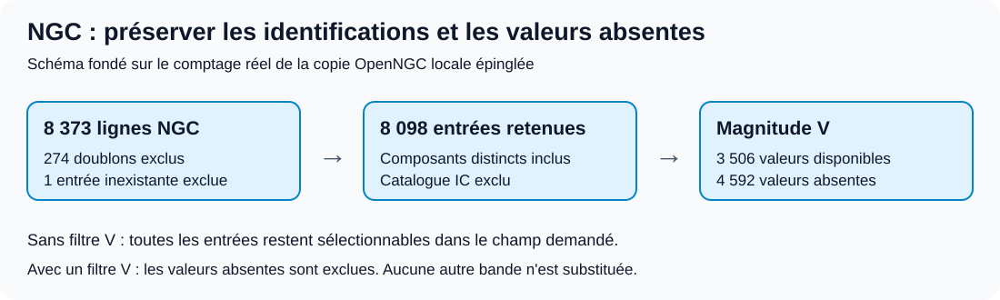

# Tutoriel : catalogues astronomiques et validation

## Utiliser le Nouveau Catalogue Général



Ce schéma explique le dénombrement réel de la copie OpenNGC épinglée; il ne
représente pas une capture d'écran ni une observation du ciel. Le commit
`3651c6e` a enregistré le plan NGC avant le développement.

```powershell
gnu-astrolist --date 2026-08-15 --time-range 21:00-02:00 --timezone America/Toronto --lat 45.57 --lon -73.68 --az-min 15 --az-max 180 --min-altitude 20 --objects ngc --offline --limit 3
```

Pour une sélection limitée aux V connues ≤ 8, ajouter `--max-magnitude 8`.
Pour obtenir les sources et un rapport exporté, ajouter `--details` et
`--output-txt local/ngc.txt --output-pdf local/ngc.pdf` après avoir créé `local/`.
Le catalogue NGC est plus volumineux que Messier : `--limit` réduit la sortie,
mais tous les candidats sont calculés avant ce dernier filtre d'affichage.

Les 8 098 entrées comprennent des sous-composants et ne correspondent pas à
8 098 numéros historiques ou objets physiques indépendants. Le groupe et ses
membres peuvent coexister. La [notice NGC](../src/gnu_astrolist/data/NGC_SOURCE.md)
documente ces conventions. La reconstruction utilise uniquement le fichier
OpenNGC local déjà disponible, avec son empreinte attendue.

Résultat réel de la commande NGC ci-dessus, sans limite de magnitude :
**1 975 entrées trouvées**, dont trois affichées.

| Objet | Type OpenNGC | Constellation | Magnitude V OpenNGC |
| --- | --- | --- | --- |
| NGC224 | G | And | 3,44 |
| NGC869 | OCl | Per | 3,7 |
| NGC884 | OCl | Per | 3,8 |

Ces lignes proviennent d'une exécution locale réelle avec le catalogue embarqué;
elles ne sont pas des observations ni une validation photométrique indépendante.
La table est précédée d'un avertissement IERS lorsque les tables disponibles
ne couvrent pas les dates calculées avec toute la précision souhaitée.

Validation du lot NGC : **65 tests réussis** sous Windows/Python 3.13.6, Ruff
et contrôles de structure/distribution réussis. Les cinq avertissements IERS
restent visibles. Le paquet a été installé sans téléchargement avec
`pip install --no-index --no-deps` dans l'environnement de vérification existant;
ses 8 098 entrées et sa commande NGC ont été vérifiées hors du dossier source.
Ce lot n'est pas publié sur GitHub; sa CI distante n'a pas été exécutée.

## Correctif avant fusion : un test indépendant de l'ordre d'exécution

La première CI a réussi sous Python 3.13 et pour les distributions, mais le test
de tri Caldwell a échoué sous Python 3.10 sur Windows et Linux avec IERSRangeError.
Le calcul saisonnier utilise des dates hors couverture des tables embarquées.
Le test définit désormais temporairement les paramètres IERS hors ligne et la
politique d'avertissement, puis restaure les valeurs précédentes. Les assertions
de sélection et de tri restent identiques; aucun résultat astronomique n'est modifié.

Le [schéma de validation locale](images/validation-locale.svg) s'applique aussi
à ce correctif : plan enregistré dans `2f0c0bd`, test isolé, suite locale puis CI
avant fusion. La publication et la fusion sont maintenant autorisées par
l'utilisateur; la restriction locale décrite plus bas documente le lot précédent.

```powershell
.venv\Scripts\python -m pytest tests/test_caldwell.py::test_visibility_sorts_unknown_magnitude_after_known_values
```


Cette image est un schéma explicatif, pas une capture d'écran ni une mesure.

Après l'[installation](../INSTALL.md), cette commande utilise les coordonnées
publiques d'exemple de Laval, sans requête météo ou mise à jour IERS :

```powershell
gnu-astrolist --date 2026-08-15 --time-range 21:00-02:00 --timezone America/Toronto --lat 45.57 --lon -73.68 --az-min 15 --az-max 180 --min-altitude 20 --objects caldwell --offline --limit 10
```

Le rapport indique le catalogue Caldwell, le résumé météo indisponible hors
ligne, les conventions lunaires et les objets qui traversent le champ. Pour
inspecter les sources de taille et de magnitude, ajouter `--details`.
Les tailles sont en minutes d'arc et la magnitude est en bande V.

Résultat réellement obtenu pour cette commande avec `--limit 3`, depuis la
wheel installée dans un environnement neuf : 35 objets trouvés, 3 affichés.

| Objet | Type | Constellation | Taille OpenNGC | V OpenNGC |
| --- | --- | --- | --- | --- |
| C28 | OCl | And | 39′ | 5,7 |
| C13 | OCl | Cas | 7,8′ | 6,4 |
| C16 | OCl | Lac | 15′ | 6,4 |

Le cheminement est le suivant :

```text
109 entrées publiques → filtre V facultatif → champ et plage horaire
                     → tri V (absences à la fin) → terminal / TXT / PDF
```

`--max-magnitude 8` retient seulement les magnitudes V connues ≤ 8.
Sans cette option, les objets sans V restent sélectionnables et portent la
mention « non disponible ». Cela ne prédit pas leur visibilité à l'œil.

Créer un dossier `local/` pour ses propres sorties, puis ajouter
`--output-txt local/soiree.txt --output-pdf local/soiree.pdf` à la commande.
Le dossier parent doit déjà exister. Ces rapports contiennent les coordonnées
d'observation : ils sont locaux et ne doivent pas accompagner une contribution.

Les commandes ci-dessus sont des exemples reproductibles, sans capture inventée.
La portée des vérifications est détaillée dans [VALIDATION.md](VALIDATION.md).

La vérification réelle des sources épinglées a reconstruit le catalogue avec
la même empreinte SHA-256 que le fichier embarqué :
`67bfe8703796713e47a975454848dc55fcaba3e5a1aa1b2be6a005b131fbac90`.
Cela vérifie la reproductibilité de la transformation, sans certifier la
précision photométrique des sources.

## Finaliser un lot uniquement dans la copie locale


Le commit de planification `f737e4d` a enregistré les sous-étapes dans ROADMAP.md
avant la finalisation. Les changements Caldwell avaient déjà été réalisés avant
ce plan; ce commit ne prétend pas les avoir précédés.

Ce lot relit la fonctionnalité, ajoute deux schémas versionnés et inscrit les
règles d'illustration et de travail local dans AGENTS.md. Le manifeste inclut
les SVG pour conserver les illustrations dans l'archive source.

Contrôles avec les outils déjà installés, sans téléchargement :

```powershell
.venv\Scripts\python -m pytest
.venv\Scripts\python -m ruff check .
.venv\Scripts\python scripts/check_repository.py
.venv\Scripts\python -m build --no-isolation
.venv\Scripts\python scripts/check_distribution.py
git diff --check
git status --short --branch
```

`--no-isolation` réutilise les outils présents. Si une dépendance de construction
manque, la construction échoue au lieu de préparer un nouvel environnement réseau.
Les résultats sont consignés dans [VALIDATION.md](VALIDATION.md).
Les commits restent locaux; les opérations GitHub et la CI distante sont différées.

### Résultats de cette finalisation

Les 61 tests ont réussi, ainsi que Ruff, le contrôle des liens locaux et celui
des distributions. Les SVG sont inclus dans l'archive source. Les quatre
avertissements IERS restent les limites connues des cas astronomiques testés.

Le premier essai de construction sans isolation a échoué car `setuptools` était
absent. La version 84.2.1 a été retrouvée dans le cache local, copiée sous
`local/build-tools/` puis installée avec `pip install --no-index --no-deps`.
La reconstruction a ensuite réussi, sans téléchargement. Le dossier `local/`
est ignoré par Git et ne fait pas partie des archives distribuées.

### Commits et revue locale

| Commit | Résultat enregistré |
| --- | --- |
| `f737e4d` | Plan et sous-étapes avant la finalisation |
| `8015cc8` | Catalogue Caldwell, provenance et tests |
| `f308106` | Cadre open source et tutoriel illustré |

Après ces commits, `git status --short --branch` n'indiquait aucune modification
sur `feat/caldwell-catalog`. La présente clôture documentaire enregistre cette
vérification. Aucun push, PR distante, fusion ou réglage GitHub n'a été effectué
pendant cette finalisation. La conception de l'archive météo reste le lot suivant
proposé dans ROADMAP.md, sans implémentation ajoutée pendant ce lot.
