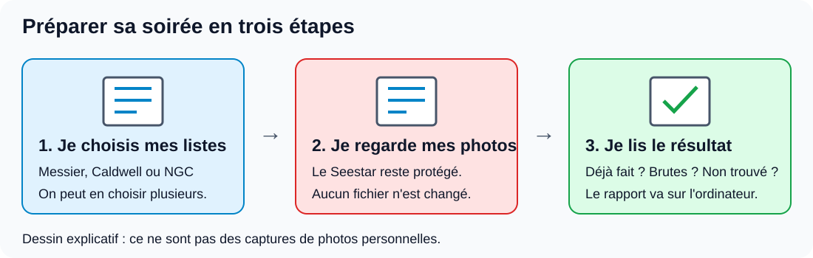
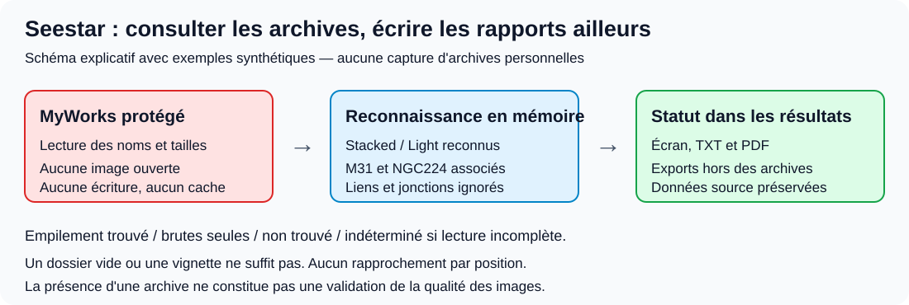
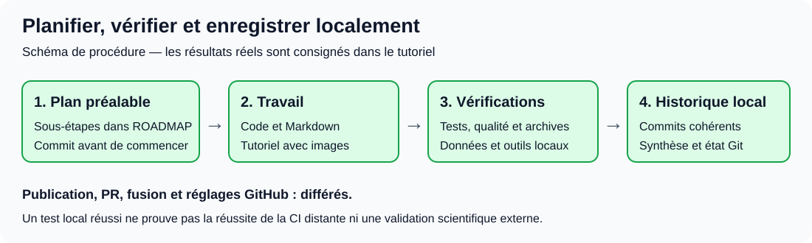

# Tutoriel : catalogues astronomiques et validation

## Commencer ici : préparer sa soirée, pas à pas

GNU Astrolist prépare une liste d'objets à regarder dans le ciel. Un **catalogue**
est une liste de noms et de positions. Messier, Caldwell et NGC sont trois listes.
Un même objet peut avoir deux noms, comme M31 et NGC224 : le programme les réunit
sur une seule ligne quand il sait qu'il s'agit du même objet.



Ce dessin explique les étapes. Il ne montre aucune photo personnelle.

### 1. Ouvrir le dossier du projet

Si le programme n'est pas encore installé, suivre [INSTALL.md](../INSTALL.md)
avec une personne qui connaît l'installation de logiciels. Les étapes suivantes
se font dans PowerShell, une fenêtre où l'on peut copier des commandes.

Ouvre PowerShell dans le dossier du projet. Crée ensuite un dossier pour les
rapports en copiant cette ligne :

Avant de continuer, vérifie que tu es dans le projet sur l'ordinateur. Si la
fenêtre indique `E:\MyWorks`, arrête-toi et ouvre le bon dossier : on ne crée
aucun dossier sur le disque des photos.

```powershell
New-Item -ItemType Directory -Force local
```

`local` est un dossier sur l'ordinateur. Ce n'est pas le disque du Seestar.
Tous les rapports doivent aller sur l'ordinateur, hors du disque des photos.

### 2. Choisir les listes et le dossier de photos

La commande ci-dessous est un exemple pour Laval. La date est un exemple,
pas une demande d'utiliser cette soirée précise. Remplace `2026-08-15` par ta
date au format année-mois-jour. `21:00-02:00` veut dire de 21 h à 2 h le lendemain.
Si tu observes ailleurs, change la latitude et la longitude avec une personne
qui connaît ton lieu d'observation. Le **fuseau horaire** indique l'heure locale.

```powershell
.venv\Scripts\python -m gnu_astrolist --date 2026-08-15 --time-range 21:00-02:00 --timezone America/Toronto --lat 45.57 --lon -73.68 --az-min 15 --az-max 180 --min-altitude 20 --objects messier caldwell ngc --offline --max-magnitude 8 --limit 20 --seestar-path "E:\MyWorks" --output-txt local/soiree.txt --output-pdf local/soiree.pdf
```

Voici les morceaux à connaître :

| Morceau de la commande | Ce que cela veut dire |
| --- | --- |
| `--objects messier caldwell ngc` | Utiliser les trois listes ensemble. |
| `--seestar-path "E:\MyWorks"` | Regarder dans ce dossier de photos. Change le chemin si ton disque porte une autre lettre. |
| `--offline` | Travailler sans demander la météo sur Internet. |
| `--limit 20` | Afficher au maximum 20 lignes. |
| `--max-magnitude 8` | Garder les objets dont la luminosité publiée passe cette limite. Un petit nombre correspond à un objet plus brillant. |
| `--az-min 15 --az-max 180` | Choisir les directions du ciel à examiner. |
| `--min-altitude 20` | Éviter les objets trop bas sur l'horizon. |
| `--output-pdf local/soiree.pdf` | Ranger le rapport PDF sur l'ordinateur. |

Avec une limite de luminosité, un objet dont la valeur manque dans la liste
n'est pas retenu. Pour garder tous les objets, enlève `--max-magnitude 8`;
pour enlever aussi la limite des étoiles variables, utilise `--all-magnitudes`.

Le programme regarde les noms et tailles des fichiers du Seestar. Il ne change
aucune photo et n'écrit aucun rapport sur ce disque. Ne remplace pas le chemin
de sortie `local/soiree.pdf` par un chemin sur le disque des photos.
Si le disque n'est pas branché, le programme affiche une erreur : vérifie le
câble et le chemin, puis recommence. Pour travailler sans ce disque, enlève
simplement `--seestar-path "E:\MyWorks"` de la commande.

### 3. Lire le résultat

Le résultat apparaît dans la fenêtre. Tu retrouves aussi `soiree.txt` et
`soiree.pdf` dans le dossier `local`. Ouvre le PDF pour lire le rapport mis en page.

| Dans la colonne Seestar | Comment le lire |
| --- | --- |
| Fait (empilé) | Une image créée en réunissant plusieurs prises a été trouvée. |
| Brutes seules | Des prises individuelles ont été trouvées, mais pas d'image réunie. |
| Brutes (incomplet) | Des prises ont été trouvées, mais une partie du dossier n'a pas pu être lue. |
| Non trouvé | Aucune image reconnue n'a été trouvée pour ce nom. |
| Indéterminé | Le programme n'a pas pu tout regarder; il ne peut pas répondre. |

« Non trouvé » ne veut pas dire « jamais photographié » : un autre nom ou une
image rangée ailleurs peut échapper à la recherche. « Fait » ne veut pas dire
que l'image est réussie : il faut encore la regarder. Les exemples détaillés
ci-dessous sont inventés pour les tests ou clairement signalés comme des essais.

## Pour aller plus loin : fonctionnement et journal des vérifications

Les sections suivantes gardent les détails utiles pour vérifier le travail et
pour les personnes qui souhaitent améliorer le programme.

## Signaler les acquisitions Seestar existantes



Le schéma et les exemples de fichiers ci-dessous sont synthétiques. Le plan a
été enregistré au commit `a52ad62` avant le développement de l'option.

```powershell
gnu-astrolist --date 2026-08-15 --time-range 21:00-02:00 --timezone America/Toronto --lat 45.57 --lon -73.68 --az-min 15 --az-max 180 --min-altitude 20 --objects messier ngc --offline --max-magnitude 8 --limit 20 --seestar-path "E:\MyWorks" --output-txt local/soiree.txt --output-pdf local/soiree.pdf
```

Créer d'abord `local/` sur le disque du projet. Le logiciel refuse d'exporter
dans les archives protégées, même via un chemin relatif ou un lien résolu.
Le PDF temporaire reste auprès de la destination de sortie autorisée.

Dans le scénario synthétique utilisé par les tests :

| Acquisition synthétique | Ligne du rapport | Statut attendu |
| --- | --- | --- |
| `Stacked_20_M 31_10.0s_LP_20260815-210000.fit` | M31 / NGC224 | Fait (empilé) |
| `Light_NGC 869_10.0s_LP_20260815-210000.fit` | NGC869 | Brutes seules |
| Aucun fichier reconnu | NGC884 | Non trouvé |
| Dossier illisible sans preuve trouvée | Objet concerné | Indéterminé |

Les tests vérifient les mêmes statuts à l'écran, dans le TXT et dans le texte
extrait du PDF. Les noms de fichiers personnels ne sont pas ajoutés au dépôt.
Un essai manuel autorisé a parcouru le véritable MyWorks en lecture de noms et
métadonnées uniquement; ses rapports sont conservés dans `local/`, ignoré par Git.
Cet essai n'a pas créé de cache ou de sortie sur le disque Seestar.

La [documentation Seestar](SEESTAR.md) décrit les motifs de fichiers reconnus,
les alias et les limites. Le statut ne valide pas la qualité des acquisitions.

La validation locale compte 89 tests réussis et un test de création de lien
symbolique ignoré faute de permission Windows, avec dix avertissements IERS.
Le comportement des jonctions est testé séparément avec leurs attributs Windows.
Les archives du logiciel et son installation hors des sources ont été vérifiées.
Aucune donnée d'acquisition personnelle n'est incluse dans les distributions.

## Réunir plusieurs catalogues dans une commande


Ce schéma décrit la procédure et les dénombrements des données embarquées;
ce n'est pas une capture d'écran. Le plan a été enregistré au commit `02b5c55`
avant le développement du lot.

```powershell
gnu-astrolist --date 2026-08-15 --time-range 21:00-02:00 --timezone America/Toronto --lat 45.57 --lon -73.68 --az-min 15 --az-max 180 --min-altitude 20 --objects messier caldwell ngc --offline --max-magnitude 8 --limit 3
```

Cette exécution locale réelle a trouvé **80 entrées**, avec trois lignes affichées :

| Objet et alias | Magnitude V | Source de la valeur retenue |
| --- | --- | --- |
| M45 | 1,2 | OpenNGC |
| M31 / NGC224 | 3,44 | SIMBAD |
| NGC869 | 3,7 | OpenNGC |

Avant filtre et sélection géométrique, les 8 317 fiches Messier/Caldwell/NGC
deviennent 8 115 fiches par regroupement de désignations identiques. Les valeurs
de la fiche prioritaire sont conservées, sans compléter silencieusement les
valeurs absentes depuis une autre fiche. Le choix précède le filtre de magnitude.
Les groupes et leurs composants restent distincts; GCVS n'est pas rapproché
par position des objets du ciel profond.

Pour utiliser les variables également, ajouter `variable_stars` après `--objects`.
Sans filtre explicite, seules les variables gardent la limite V maximum 8.
Pour supprimer cette limite aussi, utiliser `--all-magnitudes`. L'en-tête du
rapport décrit la limite réellement utilisée pour chaque catalogue.
La syntaxe répétée `--objects messier --objects ngc` produit la même sélection
que `--objects messier ngc`. Les exports TXT/PDF affichent les mêmes noms et alias.

Validation du lot : 75 tests réussis, huit avertissements IERS et contrôles
Ruff/structure/distributions réussis. Le paquet installé a été essayé hors du
dossier source, sans connexion réseau. Les avertissements de précision
astronomique restent visibles; ces tests ne valident pas les mesures des sources.

## Utiliser le Nouveau Catalogue Général


Ce schéma explique le dénombrement réel de la copie OpenNGC épinglée; il ne
représente pas une capture d'écran ni une observation du ciel. Le commit
`3651c6e` a enregistré le plan NGC avant le développement.

```powershell
gnu-astrolist --date 2026-08-15 --time-range 21:00-02:00 --timezone America/Toronto --lat 45.57 --lon -73.68 --az-min 15 --az-max 180 --min-altitude 20 --objects ngc --offline --limit 3
```

Pour une sélection limitée aux V connues ≤ 8, ajouter `--max-magnitude 8`.
Pour obtenir les sources et un rapport exporté, ajouter `--details` et
`--output-txt local/ngc.txt --output-pdf local/ngc.pdf` après avoir créé `local/`.
Le catalogue NGC est plus volumineux que Messier : `--limit` réduit la sortie,
mais tous les candidats sont calculés avant ce dernier filtre d'affichage.

Les 8 098 entrées comprennent des sous-composants et ne correspondent pas à
8 098 numéros historiques ou objets physiques indépendants. Le groupe et ses
membres peuvent coexister. La [notice NGC](../src/gnu_astrolist/data/NGC_SOURCE.md)
documente ces conventions. La reconstruction utilise uniquement le fichier
OpenNGC local déjà disponible, avec son empreinte attendue.

Résultat réel de la commande NGC ci-dessus, sans limite de magnitude :
**1 975 entrées trouvées**, dont trois affichées.

| Objet | Type OpenNGC | Constellation | Magnitude V OpenNGC |
| --- | --- | --- | --- |
| NGC224 | G | And | 3,44 |
| NGC869 | OCl | Per | 3,7 |
| NGC884 | OCl | Per | 3,8 |

Ces lignes proviennent d'une exécution locale réelle avec le catalogue embarqué;
elles ne sont pas des observations ni une validation photométrique indépendante.
La table est précédée d'un avertissement IERS lorsque les tables disponibles
ne couvrent pas les dates calculées avec toute la précision souhaitée.

Validation du lot NGC : **65 tests réussis** sous Windows/Python 3.13.6, Ruff
et contrôles de structure/distribution réussis. Les cinq avertissements IERS
restent visibles. Le paquet a été installé sans téléchargement avec
`pip install --no-index --no-deps` dans l'environnement de vérification existant;
ses 8 098 entrées et sa commande NGC ont été vérifiées hors du dossier source.
Ce lot n'est pas publié sur GitHub; sa CI distante n'a pas été exécutée.

## Correctif avant fusion : un test indépendant de l'ordre d'exécution

La première CI a réussi sous Python 3.13 et pour les distributions, mais le test
de tri Caldwell a échoué sous Python 3.10 sur Windows et Linux avec IERSRangeError.
Le calcul saisonnier utilise des dates hors couverture des tables embarquées.
Le test définit désormais temporairement les paramètres IERS hors ligne et la
politique d'avertissement, puis restaure les valeurs précédentes. Les assertions
de sélection et de tri restent identiques; aucun résultat astronomique n'est modifié.

Le [schéma de validation locale](images/validation-locale.svg) s'applique aussi
à ce correctif : plan enregistré dans `2f0c0bd`, test isolé, suite locale puis CI
avant fusion. La publication et la fusion sont maintenant autorisées par
l'utilisateur; la restriction locale décrite plus bas documente le lot précédent.

```powershell
.venv\Scripts\python -m pytest tests/test_caldwell.py::test_visibility_sorts_unknown_magnitude_after_known_values
```


Cette image est un schéma explicatif, pas une capture d'écran ni une mesure.

Après l'[installation](../INSTALL.md), cette commande utilise les coordonnées
publiques d'exemple de Laval, sans requête météo ou mise à jour IERS :

```powershell
gnu-astrolist --date 2026-08-15 --time-range 21:00-02:00 --timezone America/Toronto --lat 45.57 --lon -73.68 --az-min 15 --az-max 180 --min-altitude 20 --objects caldwell --offline --limit 10
```

Le rapport indique le catalogue Caldwell, le résumé météo indisponible hors
ligne, les conventions lunaires et les objets qui traversent le champ. Pour
inspecter les sources de taille et de magnitude, ajouter `--details`.
Les tailles sont en minutes d'arc et la magnitude est en bande V.

Résultat réellement obtenu pour cette commande avec `--limit 3`, depuis la
wheel installée dans un environnement neuf : 35 objets trouvés, 3 affichés.

| Objet | Type | Constellation | Taille OpenNGC | V OpenNGC |
| --- | --- | --- | --- | --- |
| C28 | OCl | And | 39′ | 5,7 |
| C13 | OCl | Cas | 7,8′ | 6,4 |
| C16 | OCl | Lac | 15′ | 6,4 |

Le cheminement est le suivant :

```text
109 entrées publiques → filtre V facultatif → champ et plage horaire
                     → tri V (absences à la fin) → terminal / TXT / PDF
```

`--max-magnitude 8` retient seulement les magnitudes V connues ≤ 8.
Sans cette option, les objets sans V restent sélectionnables et portent la
mention « non disponible ». Cela ne prédit pas leur visibilité à l'œil.

Créer un dossier `local/` pour ses propres sorties, puis ajouter
`--output-txt local/soiree.txt --output-pdf local/soiree.pdf` à la commande.
Le dossier parent doit déjà exister. Ces rapports contiennent les coordonnées
d'observation : ils sont locaux et ne doivent pas accompagner une contribution.

Les commandes ci-dessus sont des exemples reproductibles, sans capture inventée.
La portée des vérifications est détaillée dans [VALIDATION.md](VALIDATION.md).

La vérification réelle des sources épinglées a reconstruit le catalogue avec
la même empreinte SHA-256 que le fichier embarqué :
`67bfe8703796713e47a975454848dc55fcaba3e5a1aa1b2be6a005b131fbac90`.
Cela vérifie la reproductibilité de la transformation, sans certifier la
précision photométrique des sources.

## Finaliser un lot uniquement dans la copie locale



Le commit de planification `f737e4d` a enregistré les sous-étapes dans ROADMAP.md
avant la finalisation. Les changements Caldwell avaient déjà été réalisés avant
ce plan; ce commit ne prétend pas les avoir précédés.

Ce lot relit la fonctionnalité, ajoute deux schémas versionnés et inscrit les
règles d'illustration et de travail local dans AGENTS.md. Le manifeste inclut
les SVG pour conserver les illustrations dans l'archive source.

Contrôles avec les outils déjà installés, sans téléchargement :

```powershell
.venv\Scripts\python -m pytest
.venv\Scripts\python -m ruff check .
.venv\Scripts\python scripts/check_repository.py
.venv\Scripts\python -m build --no-isolation
.venv\Scripts\python scripts/check_distribution.py
git diff --check
git status --short --branch
```

`--no-isolation` réutilise les outils présents. Si une dépendance de construction
manque, la construction échoue au lieu de préparer un nouvel environnement réseau.
Les résultats sont consignés dans [VALIDATION.md](VALIDATION.md).
Les commits restent locaux; les opérations GitHub et la CI distante sont différées.

### Résultats de cette finalisation

Les 61 tests ont réussi, ainsi que Ruff, le contrôle des liens locaux et celui
des distributions. Les SVG sont inclus dans l'archive source. Les quatre
avertissements IERS restent les limites connues des cas astronomiques testés.

Le premier essai de construction sans isolation a échoué car `setuptools` était
absent. La version 84.2.1 a été retrouvée dans le cache local, copiée sous
`local/build-tools/` puis installée avec `pip install --no-index --no-deps`.
La reconstruction a ensuite réussi, sans téléchargement. Le dossier `local/`
est ignoré par Git et ne fait pas partie des archives distribuées.

### Commits et revue locale

| Commit | Résultat enregistré |
| --- | --- |
| `f737e4d` | Plan et sous-étapes avant la finalisation |
| `8015cc8` | Catalogue Caldwell, provenance et tests |
| `f308106` | Cadre open source et tutoriel illustré |

Après ces commits, `git status --short --branch` n'indiquait aucune modification
sur `feat/caldwell-catalog`. La présente clôture documentaire enregistre cette
vérification. Aucun push, PR distante, fusion ou réglage GitHub n'a été effectué
pendant cette finalisation. La conception de l'archive météo reste le lot suivant
proposé dans ROADMAP.md, sans implémentation ajoutée pendant ce lot.
