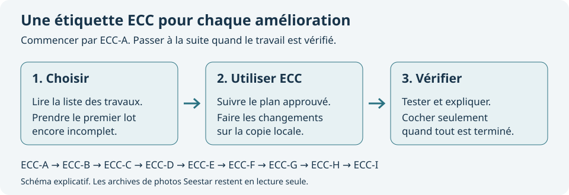
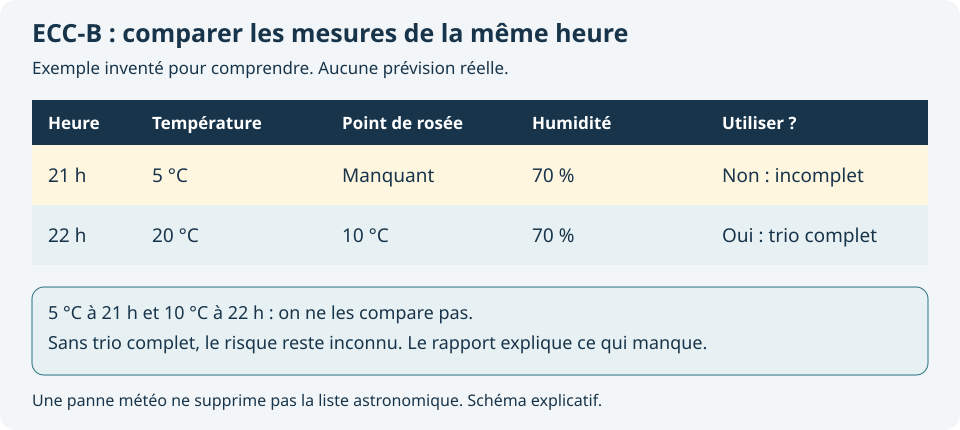
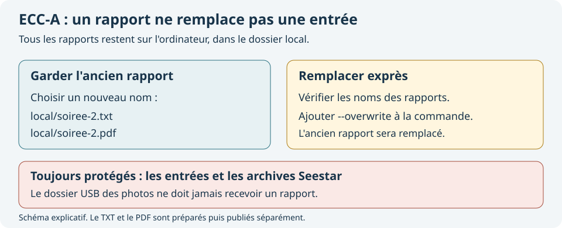
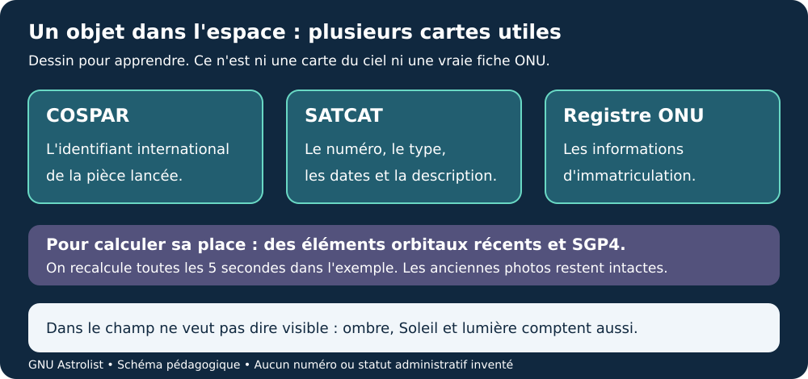
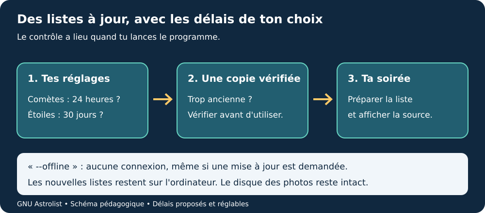
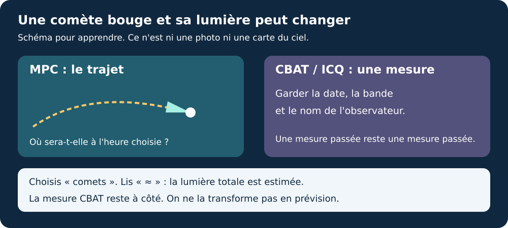
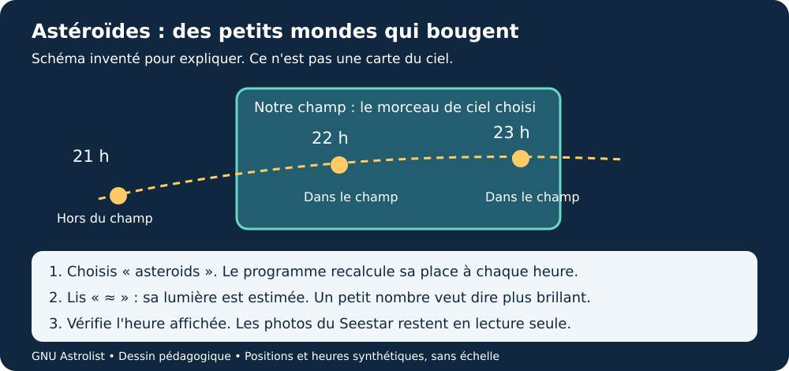
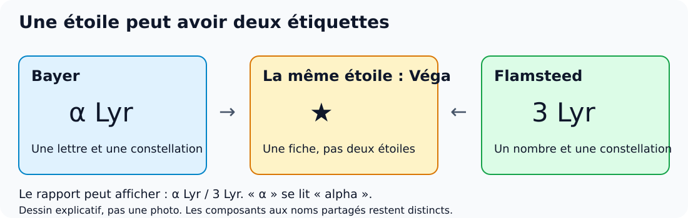
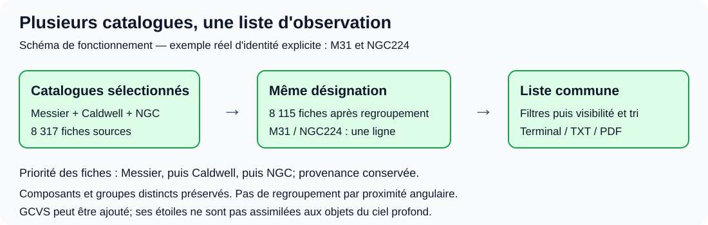

# Tutoriel : catalogues astronomiques et validation

## Les prochaines améliorations avec ECC

ECC donne des méthodes pour préparer, tester et vérifier les changements du
logiciel. Chaque groupe de travail porte une étiquette, de **ECC-A** à **ECC-I**.
Ces étiquettes sont dans la [liste des travaux](../ROADMAP.md).



Ce dessin est un schéma explicatif, pas une capture de l'application.

1. Demande « Quelle est la prochaine étape ? ».
2. La réponse indique **utiliser ECC** et la première étiquette encore ouverte.
3. **ECC-A** protège les fichiers. **ECC-B** vérifie les données météo.
   Le groupe suivant, **ECC-C**, vérifiera les réglages que tu tapes dans la commande.
4. Après les changements, on vérifie les tests et on explique le résultat.
   On coche une étape seulement quand elle est terminée.

Les neuf groupes sont approuvés. Les cases de la liste indiquent les changements
réalisés; une branche doit encore être intégrée pour les retrouver dans la
version principale. Les détails pour les personnes qui
développent sont dans le [guide ECC](DEVELOPPEMENT_ECC.md).

## Commencer ici : préparer sa soirée, pas à pas

### Comprendre une météo incomplète avec ECC-B

Parfois, un service météo envoie une case vide ou une mauvaise valeur. Le
logiciel garde ce qu'il peut lire et affiche un **avertissement** : un message
qui explique ce qui manque. Un tiret ne veut pas dire zéro.



Ce dessin utilise des valeurs inventées. Ce n'est pas une vraie prévision.

1. Regarde les valeurs et les avertissements dans le terminal, le TXT ou le PDF.
2. Pour la rosée, il faut trois mesures à la même heure : la température, le
   point de rosée et l'humidité. Le **point de rosée** est la température à
   laquelle l'eau de l'air peut commencer à se déposer en gouttes.
3. S'il manque une mesure, le logiciel ne la prend pas à une autre heure.
   Sans trio complet, il ne dit pas que le risque est faible : il le laisse inconnu.
4. Si les heures du Soleil manquent, un message annonce deux plages de secours :
   de 20 h à 23 h et de 3 h à 6 h. Ce ne sont pas forcément la vraie nuit et l'aube.

Une panne météo n'empêche pas de préparer la liste du ciel pour les erreurs de
service reconnues. `--offline` permet toujours de travailler sans demander la
météo sur Internet. Les [détails du guide météo](METEO.md) expliquent les contrôles.

### Protéger ses fichiers avec ECC-A

Un **rapport** est le fichier qui contient ta liste du ciel. Une **entrée**
est un fichier que le logiciel lit pour travailler. Il ne faut pas ranger le
rapport à la place d'une entrée.



Ce dessin explique les choix. Il ne montre aucune vraie photo ni capture d'écran.

1. Range tes rapports dans `local` sur l'ordinateur, comme dans l'exemple plus bas.
2. Donne deux noms différents au TXT et au PDF, par exemple `soiree.txt` et
   `soiree.pdf`. N'utilise pas le nom d'un fichier de catalogue ou de réglages.
3. Si le programme dit que le rapport existe déjà, choisis un nouveau nom pour
   garder les deux soirées, par exemple `soiree-2.txt` et `soiree-2.pdf`.
4. Pour remplacer exprès les anciens rapports, vérifie leurs noms avec une
   personne qui connaît les fichiers, puis ajoute `--overwrite` à la commande.
   Ce mot autorise le remplacement; il ne protège pas un document personnel
   choisi par erreur comme rapport.

Le logiciel prépare chaque rapport à côté de sa destination avant de le ranger.
Si sa préparation échoue, il garde l'ancien fichier. Le TXT et le PDF sont
rangés séparément : l'un peut réussir et l'autre échouer.

Même avec `--overwrite`, on ne remplace jamais les entrées déclarées ni les
photos dans le dossier Seestar protégé. Garde toujours les sorties sur
l'ordinateur, hors du disque USB. Les [règles complètes](EXPORTS.md) sont
destinées aux personnes qui souhaitent comprendre les détails.

GNU Astrolist prépare une liste d'objets à regarder dans le ciel. Un **catalogue**
est une liste de noms et de positions. Messier, Caldwell et NGC sont trois listes.
Un même objet peut avoir deux noms, comme M31 et NGC224 : le programme les réunit
sur une seule ligne quand il sait qu'il s'agit du même objet.


Ce dessin explique les étapes. Il ne montre aucune photo personnelle.

### 1. Ouvrir le dossier du projet

Si le programme n'est pas encore installé, suivre [INSTALL.md](../INSTALL.md)
avec une personne qui connaît l'installation de logiciels. Les étapes suivantes
se font dans PowerShell, une fenêtre où l'on peut copier des commandes.

Ouvre PowerShell dans le dossier du projet. Crée ensuite un dossier pour les
rapports en copiant cette ligne :

Avant de continuer, vérifie que tu es dans le projet sur l'ordinateur. Si la
fenêtre indique `E:\MyWorks`, arrête-toi et ouvre le bon dossier : on ne crée
aucun dossier sur le disque des photos.

```powershell
New-Item -ItemType Directory -Force local
```

`local` est un dossier sur l'ordinateur. Ce n'est pas le disque du Seestar.
Tous les rapports doivent aller sur l'ordinateur, hors du disque des photos.

### 2. Choisir les listes et le dossier de photos

La commande ci-dessous est un exemple pour Laval. La date est un exemple,
pas une demande d'utiliser cette soirée précise. Remplace `2026-08-15` par ta
date au format année-mois-jour. `21:00-02:00` veut dire de 21 h à 2 h le lendemain.
Si tu observes ailleurs, change la latitude et la longitude avec une personne
qui connaît ton lieu d'observation. Le **fuseau horaire** indique l'heure locale.

```powershell
.venv\Scripts\python -m gnu_astrolist --date 2026-08-15 --time-range 21:00-02:00 --timezone America/Toronto --lat 45.57 --lon -73.68 --az-min 15 --az-max 180 --min-altitude 20 --objects messier caldwell ngc --offline --max-magnitude 8 --limit 20 --seestar-path "E:\MyWorks" --output-txt local/soiree.txt --output-pdf local/soiree.pdf
```

Voici les morceaux à connaître :

| Morceau de la commande | Ce que cela veut dire |
| --- | --- |
| `--objects messier caldwell ngc` | Utiliser les trois listes ensemble. |
| `--seestar-path "E:\MyWorks"` | Regarder dans ce dossier de photos. Change le chemin si ton disque porte une autre lettre. |
| `--offline` | Travailler sans demander la météo sur Internet. |
| `--limit 20` | Afficher au maximum 20 lignes. |
| `--max-magnitude 8` | Garder les objets dont la luminosité publiée passe cette limite. Un petit nombre correspond à un objet plus brillant. |
| `--az-min 15 --az-max 180` | Choisir les directions du ciel à examiner. |
| `--min-altitude 20` | Éviter les objets trop bas sur l'horizon. |
| `--output-pdf local/soiree.pdf` | Ranger le rapport PDF sur l'ordinateur. |

Avec une limite de luminosité, un objet dont la valeur manque dans la liste
n'est pas retenu. Pour garder tous les objets, enlève `--max-magnitude 8`;
pour enlever aussi la limite des étoiles variables, utilise `--all-magnitudes`.

Le programme regarde les noms et tailles des fichiers du Seestar. Il ne change
aucune photo et n'écrit aucun rapport sur ce disque. Ne remplace pas le chemin
de sortie `local/soiree.pdf` par un chemin sur le disque des photos.
Si le disque n'est pas branché, le programme affiche une erreur : vérifie le
câble et le chemin, puis recommence. Pour travailler sans ce disque, enlève
simplement `--seestar-path "E:\MyWorks"` de la commande.

### 3. Lire le résultat

Le résultat apparaît dans la fenêtre. Tu retrouves aussi `soiree.txt` et
`soiree.pdf` dans le dossier `local`. Ouvre le PDF pour lire le rapport mis en page.

| Dans la colonne Seestar | Comment le lire |
| --- | --- |
| Fait (empilé) | Une image créée en réunissant plusieurs prises a été trouvée. |
| Brutes seules | Des prises individuelles ont été trouvées, mais pas d'image réunie. |
| Brutes (incomplet) | Des prises ont été trouvées, mais une partie du dossier n'a pas pu être lue. |
| Non trouvé | Aucune image reconnue n'a été trouvée pour ce nom. |
| Indéterminé | Le programme n'a pas pu tout regarder; il ne peut pas répondre. |

« Non trouvé » ne veut pas dire « jamais photographié » : un autre nom ou une
image rangée ailleurs peut échapper à la recherche. « Fait » ne veut pas dire
que l'image est réussie : il faut encore la regarder. Les exemples détaillés
ci-dessous sont inventés pour les tests ou clairement signalés comme des essais.

## Ajouter les satellites artificiels et les débris

Un **satellite artificiel** est un objet construit puis envoyé dans l'espace.
Un **débris** peut être un morceau détaché. Un ancien étage de fusée est aussi
un objet que l'on peut suivre. Ils bougent vite dans notre ciel.



C'est un schéma pour expliquer. Il ne montre aucune vraie fiche administrative.

### 1. Choisir les objets

Dans le dossier du projet sur l'ordinateur, crée `local` comme au début du guide.
Copie cet exemple pour Laval :

```powershell
.venv\Scripts\python -m gnu_astrolist --date 2026-11-17 --time-range 21:00-21:20 --timezone America/Toronto --lat 45.57 --lon -73.68 --az-min 0 --az-max 360 --min-altitude 10 --objects satellites debris --satellite-step-seconds 5 --offline --limit 5 --output-txt local/satellites.txt --output-pdf local/satellites.pdf
```

`satellites` demande les charges utiles; `debris` ajoute les morceaux et les
corps de fusées. Le programme contient une première sélection, pas tous les
objets du monde. Tu peux mélanger ces listes avec Messier ou les comètes.

### 2. Comprendre les noms et les passages

**COSPAR** donne un identifiant international à une pièce lancée.
**SATCAT/NORAD** lui donne un numéro et une description. Le **registre ONU**
conserve des informations d'immatriculation. Ce sont des rôles différents.

Pour trouver la place dans le ciel, il faut des nombres orbitaux récents.
Le programme les utilise avec une méthode appelée **SGP4**. Dans cet exemple,
il regarde toutes les cinq secondes. Une case avec une heure dit à quel instant
la position retenue a été calculée. Ce n'est pas la garantie d'un passage continu.
Si les nombres sont trop vieux, le programme les écarte et le dit.

### 3. Savoir si on pourra le voir

Un objet peut passer dans le champ alors qu'il est dans l'ombre de la Terre !
Ajoute `--satellite-optical-only` pour garder les instants où il est éclairé et
où le Soleil est assez bas chez toi. Sa lumière reste inconnue : on ne garantit
pas que tu le verras. Enlève un éventuel `--max-magnitude` pour garder les objets
dont la luminosité n'est pas fournie.

Pour chercher une copie plus récente au démarrage, enlève `--offline` et ajoute
`--update-catalogs if-stale --catalog-age satellites=6`. Le fournisseur limite
la fréquence des demandes. Une erreur peut imposer une pause; ne relance pas
en boucle. Les nouvelles listes restent sur l'ordinateur.

### 4. Comprendre le registre et les anciennes photos

Le registre ONU ne donne pas la place du satellite ce soir. Aucun extrait réel
n'est fourni avec le programme. Une personne qui dispose d'un extrait autorisé
peut préparer le fichier local décrit dans [le guide](SATELLITES.md).
Sans donnée, le programme dit que le statut est inconnu. Cela ne veut pas dire
que l'objet n'est pas immatriculé.

Pour Seestar, un nom comme `NORAD25544` ou `1998-067A` est précis. Un numéro seul
ou un nom partagé ne suffit pas. Le disque des photos reste en lecture seule;
les rapports vont dans `local` sur l'ordinateur.

## Choisir quand rafraîchir les listes

Les listes du ciel changent. Pour les comètes, les nombres qui décrivent leur
trajet sont particulièrement importants. Tu peux demander au programme de
vérifier leur âge chaque fois que tu le lances.



C'est un schéma pour expliquer le fonctionnement. Il ne montre aucune donnée privée.

1. Dans ta commande habituelle, ajoute `--update-catalogs if-stale`.
   Cela veut dire : « demande une nouvelle liste seulement si ma copie est trop vieille ».
2. Pour les comètes, ajoute `--catalog-age comets=24` pour choisir 24 heures.
   Pour les étoiles Bayer, tu peux ajouter `--catalog-age bayer=720` : 720 heures
   font 30 jours. Les réglages marchent pour tous les catalogues proposés.
3. Pour autoriser Internet, enlève `--offline`. Pour rester sans Internet,
   garde-le : aucune nouvelle liste ne sera téléchargée, même avec `force`.
4. Lis les notes du rapport : elles disent si une copie récente a été trouvée,
   si une nouvelle copie a été vérifiée, ou si l'ancienne a dû être conservée.

Le contrôle n'a lieu que pendant le lancement. Il ne continue pas quand le
programme est fermé. Les nouvelles listes vont dans `local/catalog-cache`
sur l'ordinateur. Elles ne vont jamais dans le dossier des photos Seestar.
Une panne Internet ne doit pas remplacer une bonne copie par un fichier cassé.

Avec une personne qui connaît les fichiers de réglages, tu peux préparer un
fichier pour éviter de tout recopier. Le [guide des mises à jour](CATALOG_UPDATES.md)
donne un exemple et explique les délais pour chaque source.

## Ajouter les comètes

Une **comète** est un petit monde qui peut libérer du gaz et de la poussière
près du Soleil. Elle bouge parmi les étoiles et sa lumière peut changer beaucoup.



Ce dessin explique les rôles des sources. Il ne montre aucune vraie mesure.

### 1. Demander la liste des comètes

Dans le dossier du projet sur l'ordinateur, crée `local` comme au début du guide.
Copie cette commande d'exemple pour Laval :

```powershell
.venv\Scripts\python -m gnu_astrolist --date 2026-11-17 --time-range 21:00-22:00 --timezone America/Toronto --lat 45.57 --lon -73.68 --az-min 0 --az-max 360 --min-altitude 10 --objects comets --max-magnitude 18 --offline --limit 20 --output-txt local/cometes.txt --output-pdf local/cometes.pdf
```

Pour mélanger les listes, écris par exemple `--objects comets asteroids messier`.
Pour demander des orbites plus récentes au démarrage, enlève `--offline` et
ajoute `--update-catalogs if-stale --catalog-age comets=24`.

### 2. Lire le résultat

Le **MPC** donne les nombres qui décrivent le trajet. Le programme calcule une
place et une lumière pour chaque petit moment de la soirée. Le signe **≈**
veut dire « environ ». La lumière **totale** d'une comète n'est pas une mesure
dans la bande V des étoiles. Le rapport le précise.

Certaines orbites sont trop vieilles ou n'ont pas de date d'époque. Elles ne
sont pas utilisées et le rapport dit combien ont été écartées. Un téléchargement
récent ne suffit pas à rendre tous les anciens nombres fiables.

### 3. Comprendre le complément CBAT

Le **CBAT** publie des annonces astronomiques et renvoie vers des observations
de lumière ICQ. Une observation dit ce qui a été vu **à une date précise**.
Elle n'est pas automatiquement vraie pour ce soir.

Le site n'a pas pu être lu pendant ce travail. Aucune vraie mesure CBAT n'est
donc fournie. Une personne qui possède un extrait autorisé peut préparer un
fichier local et ajouter `--cbat-file local/cbat.csv`. Le
[guide des comètes](COMETS.md) décrit son format. La mesure apparaît à côté
de la prévision, avec sa date et sa source. On ne mélange pas les deux.

Pour Seestar, utiliser un identifiant complet comme `161P` ou `C_2023_A3`.
Le nom `ATLAS` seul ne suffit pas : plusieurs comètes portent ce nom.
Le disque des photos reste en lecture seule et les rapports restent dans `local`.

## Chercher des astéroïdes : une liste qui bouge

Un **astéroïde** est un petit monde qui tourne autour du Soleil. Il change de
place parmi les étoiles. On doit donc recalculer sa place pendant la soirée.



C'est un dessin pour expliquer, pas une vraie carte du ciel.

### 1. Choisir la liste

Le programme contient les 1 000 premiers astéroïdes numérotés. Par exemple,
le numéro 1 s'appelle Ceres et le numéro 4 s'appelle Vesta. Ce ne sont pas tous
les astéroïdes connus. Ouvre le dossier du projet sur l'ordinateur et crée
`local` comme au début du tutoriel. Copie ensuite :

```powershell
.venv\Scripts\python -m gnu_astrolist --date 2026-11-17 --time-range 21:00-22:00 --timezone America/Toronto --lat 45.57 --lon -73.68 --az-min 0 --az-max 360 --min-altitude 10 --objects asteroids --max-magnitude 10 --offline --limit 20 --output-txt local/asteroides.txt --output-pdf local/asteroides.pdf
```

Cette soirée est un exemple pour Laval. Les directions `0` à `360` veulent dire
« tout autour de nous ». Pour retrouver ton champ habituel, remets tes directions.
Pour ajouter les objets Messier, écris `--objects asteroids messier`.

### 2. Lire la lumière et l'heure

La **magnitude** est un nombre qui décrit la lumière. Un petit nombre veut dire
plus brillant. Le signe **≈** veut dire « environ » : la lumière est estimée.
La colonne **Instant V estimée (local)** dit à quelle heure cette estimation
correspond. Le programme garde un objet seulement s'il est assez brillant
pendant qu'il est dans le morceau de ciel choisi.

Les cases des dates saisonnières restent vides pour ces objets. Ce calcul
n'est pas encore proposé pour les astéroïdes. Une case vide de lever ou de
coucher veut dire qu'aucun passage n'a été trouvé dans les heures demandées.

### 3. Garder les éléments à jour

Les éléments orbitaux sont les nombres qui décrivent le trajet. Ils vieillissent.
Avec la copie fournie, choisis une soirée entre juin 2025 et début juin 2027,
en évitant les jours limites. Si le programme demande des éléments plus récents,
une personne qui connaît les catalogues peut préparer un fichier JPL local et
ajouter `--asteroids-file local/orbites-sbdb.json`. Le
[guide détaillé](ASTEROIDS.md) explique le format et les dates exactes.

Les calculs restent approximatifs. Pour pointer très précisément le télescope,
vérifie aussi la position dans JPL Horizons avec une personne qui sait l'utiliser.
Pour chercher tes anciennes photos, ajoute `--seestar-path "E:\MyWorks"`.
Un nom comme **MPC4** veut dire Vesta. **M4** est un autre objet, du catalogue
Messier ! Le disque des photos reste en lecture seule; les rapports restent
dans `local` sur l'ordinateur.

## Choisir les noms Bayer et Flamsteed



Une étoile peut porter plusieurs noms. **Bayer** utilise notamment une lettre
grecque : `α Lyr` se lit « alpha de la Lyre ». **Flamsteed** utilise un nombre :
la même étoile porte aussi le nom `3 Lyr`. Son nom courant est Véga.
`Lyr` est un petit code pour la constellation de la Lyre, une région du ciel.
Tu n'as pas besoin de taper les lettres grecques : le programme les écrit pour toi.
HYG est le nom de la liste de référence utilisée pour ces étoiles.

Pour essayer, copie cette commande dans le projet installé sur ton ordinateur :

```powershell
.venv\Scripts\python -m gnu_astrolist --date 2026-11-17 --time-range 21:00-22:00 --timezone America/Toronto --lat 45.57 --lon -73.68 --az-min 0 --az-max 360 --min-altitude 20 --objects bayer flamsteed --offline --limit 3
```

La date et le lieu sont un exemple pour Laval; change-les pour ta soirée.
Pour une seule liste, remplace `bayer flamsteed` par `bayer` ou `flamsteed`.
Tu peux aussi ajouter `messier` ou `ngc` après `--objects`. Les deux étiquettes
d'une même fiche HYG sont réunies, sans compter cette fiche deux fois.

Lors de cet essai local réel, 1 414 fiches ont traversé le champ choisi :

| Dans le rapport | Nom courant | Luminosité de référence |
| --- | --- | --- |
| α Lyr / 3 Lyr | Véga | 0,03 |
| α Aur / 13 Aur | Capella | 0,08 |
| α Ori / 58 Ori | Bételgeuse | 0,45 |

Ces nombres viennent d'une liste de référence. Ce n'est pas une mesure du ciel
prise ce soir et certaines étoiles changent de luminosité. L'image ci-dessus
est un dessin explicatif, pas une photo du Seestar.

Avec `--seestar-path`, le programme reconnaît des formes comme `Alp Lyr`,
`alpha Lyr`, `α Lyr`, `3 Lyr` et le nom courant exact fourni par HYG. Pour une
paire d'étoiles proches partageant une étiquette, une photo avec ce seul
nom donne « Indéterminé (nom partagé) ». On ne devine pas laquelle est photographiée.
La protection du disque reste la même : aucune photo n'est changée.

### Détails pour vérifier le travail

Le plan a été commité avant le code (`691f039`), puis complété pour les polices
grecques (`d5c94af`). La source HYG est conservée localement, avec son empreinte.
Les deux catalogues sont générés sans réseau depuis cette copie. La police Vera
ne restituait pas les noms grecs dans le PDF; DejaVu Sans et sa licence sont
maintenant embarqués. Les tests vérifient ces lettres dans le texte extrait du PDF.

La validation locale compte 102 tests réussis, un test de lien symbolique ignoré
faute de permission et treize avertissements IERS. Les archives du logiciel et
une installation hors des sources ont été vérifiées. L'exemple de rapport a été
généré sans ouvrir le disque Seestar réel. Les avertissements astronomiques ne
sont pas masqués, et les données de référence ne deviennent pas des observations.

## Pour aller plus loin : fonctionnement et journal des vérifications

Les sections suivantes gardent les détails utiles pour vérifier le travail et
pour les personnes qui souhaitent améliorer le programme.

### Préparer une copie neuve pour les tests automatiques

Les tests utilisent de fausses photos dans un dossier temporaire du projet.
Sur une copie neuve, le dossier qui doit les accueillir n'existe pas encore.
La préparation crée donc d'abord `.pytest_cache`, puis lance les tests dans
`.pytest_cache/ci-tmp`. C'est comme préparer une boîte vide avant d'y ranger
des cartes de jeu. Cette boîte est dans le projet : le disque des vraies photos
reste en lecture seule. Ce point a été corrigé après un essai GitHub sur copie neuve.

Un chemin de dossier très long peut aussi couper une phrase en deux lignes
dans un PDF. Le test du PDF tient compte de ce simple changement de ligne;
il continue à vérifier les mots et les statuts affichés.

## Signaler les acquisitions Seestar existantes


Le schéma et les exemples de fichiers ci-dessous sont synthétiques. Le plan a
été enregistré au commit `a52ad62` avant le développement de l'option.

```powershell
gnu-astrolist --date 2026-08-15 --time-range 21:00-02:00 --timezone America/Toronto --lat 45.57 --lon -73.68 --az-min 15 --az-max 180 --min-altitude 20 --objects messier ngc --offline --max-magnitude 8 --limit 20 --seestar-path "E:\MyWorks" --output-txt local/soiree.txt --output-pdf local/soiree.pdf
```

Créer d'abord `local/` sur le disque du projet. Le logiciel refuse d'exporter
dans les archives protégées, même via un chemin relatif ou un lien résolu.
Le PDF temporaire reste auprès de la destination de sortie autorisée.

Dans le scénario synthétique utilisé par les tests :

| Acquisition synthétique | Ligne du rapport | Statut attendu |
| --- | --- | --- |
| `Stacked_20_M 31_10.0s_LP_20260815-210000.fit` | M31 / NGC224 | Fait (empilé) |
| `Light_NGC 869_10.0s_LP_20260815-210000.fit` | NGC869 | Brutes seules |
| Aucun fichier reconnu | NGC884 | Non trouvé |
| Dossier illisible sans preuve trouvée | Objet concerné | Indéterminé |

Les tests vérifient les mêmes statuts à l'écran, dans le TXT et dans le texte
extrait du PDF. Les noms de fichiers personnels ne sont pas ajoutés au dépôt.
Un essai manuel autorisé a parcouru le véritable MyWorks en lecture de noms et
métadonnées uniquement; ses rapports sont conservés dans `local/`, ignoré par Git.
Cet essai n'a pas créé de cache ou de sortie sur le disque Seestar.

La [documentation Seestar](SEESTAR.md) décrit les motifs de fichiers reconnus,
les alias et les limites. Le statut ne valide pas la qualité des acquisitions.

La validation locale compte 89 tests réussis et un test de création de lien
symbolique ignoré faute de permission Windows, avec dix avertissements IERS.
Le comportement des jonctions est testé séparément avec leurs attributs Windows.
Les archives du logiciel et son installation hors des sources ont été vérifiées.
Aucune donnée d'acquisition personnelle n'est incluse dans les distributions.

## Réunir plusieurs catalogues dans une commande



Ce schéma décrit la procédure et les dénombrements des données embarquées;
ce n'est pas une capture d'écran. Le plan a été enregistré au commit `02b5c55`
avant le développement du lot.

```powershell
gnu-astrolist --date 2026-08-15 --time-range 21:00-02:00 --timezone America/Toronto --lat 45.57 --lon -73.68 --az-min 15 --az-max 180 --min-altitude 20 --objects messier caldwell ngc --offline --max-magnitude 8 --limit 3
```

Cette exécution locale réelle a trouvé **80 entrées**, avec trois lignes affichées :

| Objet et alias | Magnitude V | Source de la valeur retenue |
| --- | --- | --- |
| M45 | 1,2 | OpenNGC |
| M31 / NGC224 | 3,44 | SIMBAD |
| NGC869 | 3,7 | OpenNGC |

Avant filtre et sélection géométrique, les 8 317 fiches Messier/Caldwell/NGC
deviennent 8 115 fiches par regroupement de désignations identiques. Les valeurs
de la fiche prioritaire sont conservées, sans compléter silencieusement les
valeurs absentes depuis une autre fiche. Le choix précède le filtre de magnitude.
Les groupes et leurs composants restent distincts; GCVS n'est pas rapproché
par position des objets du ciel profond.

Pour utiliser les variables également, ajouter `variable_stars` après `--objects`.
Sans filtre explicite, seules les variables gardent la limite V maximum 8.
Pour supprimer cette limite aussi, utiliser `--all-magnitudes`. L'en-tête du
rapport décrit la limite réellement utilisée pour chaque catalogue.
La syntaxe répétée `--objects messier --objects ngc` produit la même sélection
que `--objects messier ngc`. Les exports TXT/PDF affichent les mêmes noms et alias.

Validation du lot : 75 tests réussis, huit avertissements IERS et contrôles
Ruff/structure/distributions réussis. Le paquet installé a été essayé hors du
dossier source, sans connexion réseau. Les avertissements de précision
astronomique restent visibles; ces tests ne valident pas les mesures des sources.

## Utiliser le Nouveau Catalogue Général


Ce schéma explique le dénombrement réel de la copie OpenNGC épinglée; il ne
représente pas une capture d'écran ni une observation du ciel. Le commit
`3651c6e` a enregistré le plan NGC avant le développement.

```powershell
gnu-astrolist --date 2026-08-15 --time-range 21:00-02:00 --timezone America/Toronto --lat 45.57 --lon -73.68 --az-min 15 --az-max 180 --min-altitude 20 --objects ngc --offline --limit 3
```

Pour une sélection limitée aux V connues ≤ 8, ajouter `--max-magnitude 8`.
Pour obtenir les sources et un rapport exporté, ajouter `--details` et
`--output-txt local/ngc.txt --output-pdf local/ngc.pdf` après avoir créé `local/`.
Le catalogue NGC est plus volumineux que Messier : `--limit` réduit la sortie,
mais tous les candidats sont calculés avant ce dernier filtre d'affichage.

Les 8 098 entrées comprennent des sous-composants et ne correspondent pas à
8 098 numéros historiques ou objets physiques indépendants. Le groupe et ses
membres peuvent coexister. La [notice NGC](../src/gnu_astrolist/data/NGC_SOURCE.md)
documente ces conventions. La reconstruction utilise uniquement le fichier
OpenNGC local déjà disponible, avec son empreinte attendue.

Résultat réel de la commande NGC ci-dessus, sans limite de magnitude :
**1 975 entrées trouvées**, dont trois affichées.

| Objet | Type OpenNGC | Constellation | Magnitude V OpenNGC |
| --- | --- | --- | --- |
| NGC224 | G | And | 3,44 |
| NGC869 | OCl | Per | 3,7 |
| NGC884 | OCl | Per | 3,8 |

Ces lignes proviennent d'une exécution locale réelle avec le catalogue embarqué;
elles ne sont pas des observations ni une validation photométrique indépendante.
La table est précédée d'un avertissement IERS lorsque les tables disponibles
ne couvrent pas les dates calculées avec toute la précision souhaitée.

Validation du lot NGC : **65 tests réussis** sous Windows/Python 3.13.6, Ruff
et contrôles de structure/distribution réussis. Les cinq avertissements IERS
restent visibles. Le paquet a été installé sans téléchargement avec
`pip install --no-index --no-deps` dans l'environnement de vérification existant;
ses 8 098 entrées et sa commande NGC ont été vérifiées hors du dossier source.
Ce lot n'est pas publié sur GitHub; sa CI distante n'a pas été exécutée.

## Correctif avant fusion : un test indépendant de l'ordre d'exécution

La première CI a réussi sous Python 3.13 et pour les distributions, mais le test
de tri Caldwell a échoué sous Python 3.10 sur Windows et Linux avec IERSRangeError.
Le calcul saisonnier utilise des dates hors couverture des tables embarquées.
Le test définit désormais temporairement les paramètres IERS hors ligne et la
politique d'avertissement, puis restaure les valeurs précédentes. Les assertions
de sélection et de tri restent identiques; aucun résultat astronomique n'est modifié.

Le [schéma de validation locale](images/validation-locale.svg) s'applique aussi
à ce correctif : plan enregistré dans `2f0c0bd`, test isolé, suite locale puis CI
avant fusion. La publication et la fusion sont maintenant autorisées par
l'utilisateur; la restriction locale décrite plus bas documente le lot précédent.

```powershell
.venv\Scripts\python -m pytest tests/test_caldwell.py::test_visibility_sorts_unknown_magnitude_after_known_values
```


Cette image est un schéma explicatif, pas une capture d'écran ni une mesure.

Après l'[installation](../INSTALL.md), cette commande utilise les coordonnées
publiques d'exemple de Laval, sans requête météo ou mise à jour IERS :

```powershell
gnu-astrolist --date 2026-08-15 --time-range 21:00-02:00 --timezone America/Toronto --lat 45.57 --lon -73.68 --az-min 15 --az-max 180 --min-altitude 20 --objects caldwell --offline --limit 10
```

Le rapport indique le catalogue Caldwell, le résumé météo indisponible hors
ligne, les conventions lunaires et les objets qui traversent le champ. Pour
inspecter les sources de taille et de magnitude, ajouter `--details`.
Les tailles sont en minutes d'arc et la magnitude est en bande V.

Résultat réellement obtenu pour cette commande avec `--limit 3`, depuis la
wheel installée dans un environnement neuf : 35 objets trouvés, 3 affichés.

| Objet | Type | Constellation | Taille OpenNGC | V OpenNGC |
| --- | --- | --- | --- | --- |
| C28 | OCl | And | 39′ | 5,7 |
| C13 | OCl | Cas | 7,8′ | 6,4 |
| C16 | OCl | Lac | 15′ | 6,4 |

Le cheminement est le suivant :

```text
109 entrées publiques → filtre V facultatif → champ et plage horaire
                     → tri V (absences à la fin) → terminal / TXT / PDF
```

`--max-magnitude 8` retient seulement les magnitudes V connues ≤ 8.
Sans cette option, les objets sans V restent sélectionnables et portent la
mention « non disponible ». Cela ne prédit pas leur visibilité à l'œil.

Créer un dossier `local/` pour ses propres sorties, puis ajouter
`--output-txt local/soiree.txt --output-pdf local/soiree.pdf` à la commande.
Le dossier parent doit déjà exister. Ces rapports contiennent les coordonnées
d'observation : ils sont locaux et ne doivent pas accompagner une contribution.

Les commandes ci-dessus sont des exemples reproductibles, sans capture inventée.
La portée des vérifications est détaillée dans [VALIDATION.md](VALIDATION.md).

La vérification réelle des sources épinglées a reconstruit le catalogue avec
la même empreinte SHA-256 que le fichier embarqué :
`67bfe8703796713e47a975454848dc55fcaba3e5a1aa1b2be6a005b131fbac90`.
Cela vérifie la reproductibilité de la transformation, sans certifier la
précision photométrique des sources.

## Finaliser un lot uniquement dans la copie locale


Le commit de planification `f737e4d` a enregistré les sous-étapes dans ROADMAP.md
avant la finalisation. Les changements Caldwell avaient déjà été réalisés avant
ce plan; ce commit ne prétend pas les avoir précédés.

Ce lot relit la fonctionnalité, ajoute deux schémas versionnés et inscrit les
règles d'illustration et de travail local dans AGENTS.md. Le manifeste inclut
les SVG pour conserver les illustrations dans l'archive source.

Contrôles avec les outils déjà installés, sans téléchargement :

```powershell
.venv\Scripts\python -m pytest
.venv\Scripts\python -m ruff check .
.venv\Scripts\python scripts/check_repository.py
.venv\Scripts\python -m build --no-isolation
.venv\Scripts\python scripts/check_distribution.py
git diff --check
git status --short --branch
```

`--no-isolation` réutilise les outils présents. Si une dépendance de construction
manque, la construction échoue au lieu de préparer un nouvel environnement réseau.
Les résultats sont consignés dans [VALIDATION.md](VALIDATION.md).
Les commits restent locaux; les opérations GitHub et la CI distante sont différées.

### Résultats de cette finalisation

Les 61 tests ont réussi, ainsi que Ruff, le contrôle des liens locaux et celui
des distributions. Les SVG sont inclus dans l'archive source. Les quatre
avertissements IERS restent les limites connues des cas astronomiques testés.

Le premier essai de construction sans isolation a échoué car `setuptools` était
absent. La version 84.2.1 a été retrouvée dans le cache local, copiée sous
`local/build-tools/` puis installée avec `pip install --no-index --no-deps`.
La reconstruction a ensuite réussi, sans téléchargement. Le dossier `local/`
est ignoré par Git et ne fait pas partie des archives distribuées.

### Commits et revue locale

| Commit | Résultat enregistré |
| --- | --- |
| `f737e4d` | Plan et sous-étapes avant la finalisation |
| `8015cc8` | Catalogue Caldwell, provenance et tests |
| `f308106` | Cadre open source et tutoriel illustré |

Après ces commits, `git status --short --branch` n'indiquait aucune modification
sur `feat/caldwell-catalog`. La présente clôture documentaire enregistre cette
vérification. Aucun push, PR distante, fusion ou réglage GitHub n'a été effectué
pendant cette finalisation. La conception de l'archive météo reste le lot suivant
proposé dans ROADMAP.md, sans implémentation ajoutée pendant ce lot.
