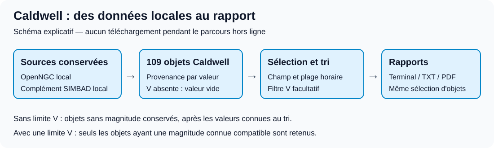

# Préparer une liste Caldwell hors ligne



Cette image est un schéma explicatif, pas une capture d'écran ni une mesure.

Après l'[installation](../INSTALL.md), cette commande utilise les coordonnées
publiques d'exemple de Laval, sans requête météo ou mise à jour IERS :

```powershell
gnu-astrolist --date 2026-08-15 --time-range 21:00-02:00 --timezone America/Toronto --lat 45.57 --lon -73.68 --az-min 15 --az-max 180 --min-altitude 20 --objects caldwell --offline --limit 10
```

Le rapport indique le catalogue Caldwell, le résumé météo indisponible hors
ligne, les conventions lunaires et les objets qui traversent le champ. Pour
inspecter les sources de taille et de magnitude, ajouter `--details`.
Les tailles sont en minutes d'arc et la magnitude est en bande V.

Résultat réellement obtenu pour cette commande avec `--limit 3`, depuis la
wheel installée dans un environnement neuf : 35 objets trouvés, 3 affichés.

| Objet | Type | Constellation | Taille OpenNGC | V OpenNGC |
| --- | --- | --- | --- | --- |
| C28 | OCl | And | 39′ | 5,7 |
| C13 | OCl | Cas | 7,8′ | 6,4 |
| C16 | OCl | Lac | 15′ | 6,4 |

Le cheminement est le suivant :

```text
109 entrées publiques → filtre V facultatif → champ et plage horaire
                     → tri V (absences à la fin) → terminal / TXT / PDF
```

`--max-magnitude 8` retient seulement les magnitudes V connues ≤ 8.
Sans cette option, les objets sans V restent sélectionnables et portent la
mention « non disponible ». Cela ne prédit pas leur visibilité à l'œil.

Créer un dossier `local/` pour ses propres sorties, puis ajouter
`--output-txt local/soiree.txt --output-pdf local/soiree.pdf` à la commande.
Le dossier parent doit déjà exister. Ces rapports contiennent les coordonnées
d'observation : ils sont locaux et ne doivent pas accompagner une contribution.

Les commandes ci-dessus sont des exemples reproductibles, sans capture inventée.
La portée des vérifications est détaillée dans [VALIDATION.md](VALIDATION.md).

La vérification réelle des sources épinglées a reconstruit le catalogue avec
la même empreinte SHA-256 que le fichier embarqué :
`67bfe8703796713e47a975454848dc55fcaba3e5a1aa1b2be6a005b131fbac90`.
Cela vérifie la reproductibilité de la transformation, sans certifier la
précision photométrique des sources.

## Finaliser un lot uniquement dans la copie locale


Le commit de planification `f737e4d` a enregistré les sous-étapes dans ROADMAP.md
avant la finalisation. Les changements Caldwell avaient déjà été réalisés avant
ce plan; ce commit ne prétend pas les avoir précédés.

Ce lot relit la fonctionnalité, ajoute deux schémas versionnés et inscrit les
règles d'illustration et de travail local dans AGENTS.md. Le manifeste inclut
les SVG pour conserver les illustrations dans l'archive source.

Contrôles avec les outils déjà installés, sans téléchargement :

```powershell
.venv\Scripts\python -m pytest
.venv\Scripts\python -m ruff check .
.venv\Scripts\python scripts/check_repository.py
.venv\Scripts\python -m build --no-isolation
.venv\Scripts\python scripts/check_distribution.py
git diff --check
git status --short --branch
```

`--no-isolation` réutilise les outils présents. Si une dépendance de construction
manque, la construction échoue au lieu de préparer un nouvel environnement réseau.
Les résultats sont consignés dans [VALIDATION.md](VALIDATION.md).
Les commits restent locaux; les opérations GitHub et la CI distante sont différées.

### Résultats de cette finalisation

Les 61 tests ont réussi, ainsi que Ruff, le contrôle des liens locaux et celui
des distributions. Les SVG sont inclus dans l'archive source. Les quatre
avertissements IERS restent les limites connues des cas astronomiques testés.

Le premier essai de construction sans isolation a échoué car `setuptools` était
absent. La version 84.2.1 a été retrouvée dans le cache local, copiée sous
`local/build-tools/` puis installée avec `pip install --no-index --no-deps`.
La reconstruction a ensuite réussi, sans téléchargement. Le dossier `local/`
est ignoré par Git et ne fait pas partie des archives distribuées.
